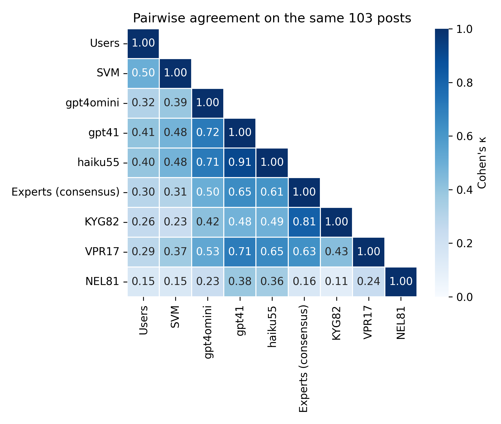

# LLMs align more closely with experts than with self-reported labels when classifying mental-health posts

[](https://colab.research.google.com/github/sargaleano/mental-health-label-agreement/blob/main/mental_health_label_agreement.ipynb)
[](https://www.nature.com/articles/s41598-025-08031-0)
[](LICENSE)
[](https://creativecommons.org/licenses/by/4.0/)
[](https://www.python.org/)

Code and data for a *Matters Arising* comment on Kallstenius et al., "Comparing traditional natural language processing and large language models for mental health status classification: a multi-model evaluation", *Scientific Reports* **15**, 24102 (2025), [doi:10.1038/s41598-025-08031-0](https://doi.org/10.1038/s41598-025-08031-0).

The original study ranked a TF-IDF + SVM classifier (95% accuracy) above a prompted LLM (65%) by agreement with the self-reported labels of the Kaggle *Sentiment Analysis for Mental Health* corpus. In this study, three clinical psychologists rated 103 posts from that corpus blind to the original labels. GPT-4o-mini, the original study's model, agreed with their consensus on 61% of posts and with the original labels on 42%; a re-implementation of the SVM showed the opposite pattern (46% and 57%). We also compared with labels given by more advanced models (GPT-4.1, Haiku-5.5).

<p align="center">
  
</p>

## Contents

| Path | What it is |
|---|---|
| `mental_health_label_agreement.ipynb` | Full analysis pipeline: expert labels, LLM labelling, SVM replication, agreement, confusion matrices, length stratification, shortcut check. Reproduces every number and figure in the paper. |
| `mental_health_rating_tool.ipynb` | Colab interface used by the experts to rate the posts (displays only the post text). |
| `data/` | Expert ratings of the 103 posts (raters identified by code only). |
| `out/` | Saved outputs of the analysis notebook, including every raw LLM response. |
| `figures/` | Figures of the paper. |

## Reproducing the results

Nothing needs to be run to inspect the results: every cell's output is saved in the notebook.

To re-run it:

1. Download the corpus from [Kaggle](https://www.kaggle.com/datasets/suchintikasarkar/sentiment-analysis-for-mental-health) and place `sentiment-analysis-for-mental-health.zip` in `data/` (it is not redistributed here).
2. Open the notebook in Colab (badge above), copy `data/` and `out/` to your Google Drive, and set `DATA_DIR` and `OUT_DIR` in the first code cell.
3. Run all cells. With `out/` in place the notebook reuses the saved LLM responses and SVM labels: no API calls are made and every number is reproduced exactly.

To relabel from scratch, delete `out/llm_raw_*.jsonl` and `out/svm_labels.csv`, and add `OPENAI_API_KEY` and `ANTHROPIC_API_KEY` to Colab Secrets. The SVM step takes about 40 minutes on a Colab CPU; LLM costs are under US$1 per model. Seeds are fixed (`SEED = 42`), but LLM responses may vary slightly between runs even at temperature 0.

## Citation

```bibtex
@article{rojasgaleano2026matters,
  author  = {Rojas-Galeano, Sergio and others},
  title   = {LLMs align more closely with experts than with self-reported labels when classifying mental-health posts},
  journal = {Scientific Reports},
  year    = {2026},
  note    = {Matters Arising}
}
```

## Licence

Code: [MIT](LICENSE). Expert ratings and LLM outputs: [CC BY 4.0](https://creativecommons.org/licenses/by/4.0/). Post texts belong to the original Kaggle corpus and its sources.
